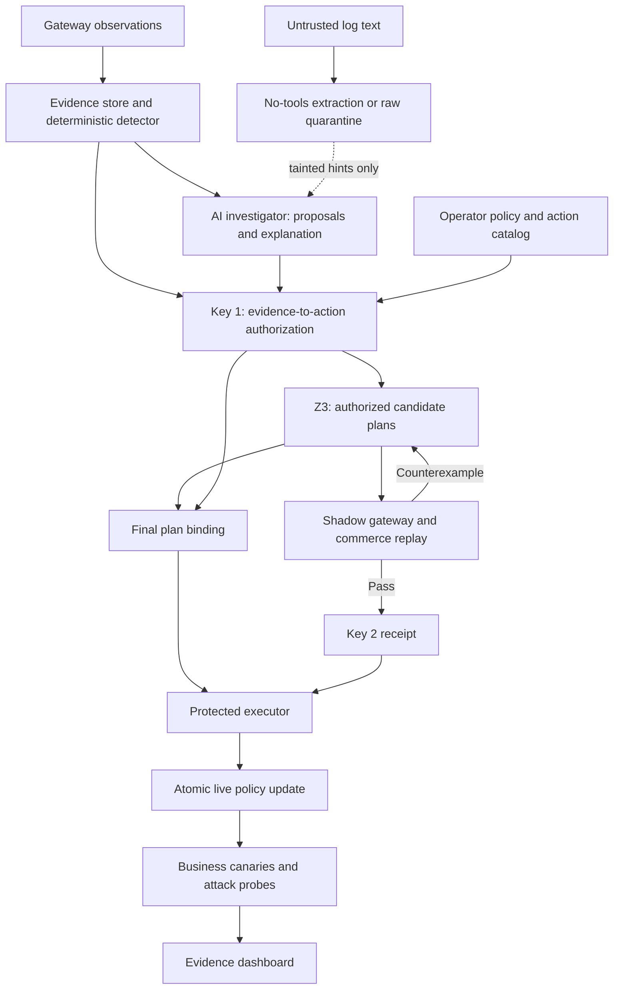

# TwoKey: build and implementation specification

Prepared 18 October 2026. Planning artifact; the system and benchmark described here have not been implemented or measured.

## 1. The product to build

**TwoKey is an authorization and verification layer for automated incident response. It permits a bounded gateway policy change only when evidence authorizes the action and an isolated replay passes the attack and business checks.**

Build a working response gateway around a small, real commerce application. A judge should be able to submit adversarial text, inspect why a dangerous action was rejected, watch a solver select a containment plan, inspect actual HTTP replay results, and verify that the applied policy preserves checkout.

The strongest differentiator is the complete, inspectable chain:

**Evidence → authorized actions → constrained plan → executable replay → bound approval receipts → atomic application → measured outcomes.**

Use this product subtitle in technical material: **“Evidence-authorized containment, verified against your business workflows.”** Keep TwoKey as the brand. The existing absolute title is an ambition; the demonstrable claim is narrower.

### The demonstration contract

For a fixed lab configuration, action catalog and test suite:

1. A model cannot turn an attacker-written target name into authority to modify that target.
2. A model cannot close an incident or suppress containment by calling the attack an approved backup.
3. A candidate plan cannot reach the protected gateway without both valid approval receipts for that exact plan.
4. The selected plan must prevent the suite's unauthorized effects while preserving every required business assertion.
5. Failure, uncertainty, stale state or incompatible requirements must produce a visible blocked/escalated state.

This is a bounded prototype contract. It does not establish universal prompt-injection immunity, production availability, legal compliance or reduced insurance premiums.

### What makes it competitive

- **Impact:** demonstrate the security and operational consequences together: synthetic data leaving, checkout success, and recovery behavior.
- **Originality:** the integrated evidence authorization, solver, replay feedback and receipt-bound execution are the contribution. Avoid claiming that provenance, solvers, SOAR or replay are individually new.
- **Technical depth:** make the decision inspectable through predicates, constraints, counterexamples, version checks and executable tests.
- **Usability:** a judge understands the outcome in 15 seconds and can inspect the mechanism in another minute.
- **Credibility:** publish unsuccessful runs, explicit assumptions, benchmark inputs and reproducible commands.

No ranking or victory probability can be substantiated. This scope is designed to make the strongest case through a demonstrable implementation.

## 2. Assumptions and scope

Plan for two people and a conservative 24-hour build window. Use the official event schedule and rules as the authority for when implementation may begin. The event page describes AI/cybersecurity, originality, and use of third-party tools; disclose reused dependencies and AI assistance in the submission. [CyberForge event](https://hackculture.io/hackathons/cyberforge-hackathon-2026)

### Required by submission

- One real synthetic commerce application with checkout, payment ledger, inventory and reports.
- Separate protected live and shadow instances, with separate databases.
- A deterministic incident detector for one well-defined synthetic export incident.
- A typed evidence store with field-level origin and influence labels.
- A finite gateway action catalog and deterministic Key 1 verifier.
- A Z3 planner using hard security/business constraints and explicit objectives.
- Real HTTP replay and semantic assertions for Key 2.
- Two receipts bound to the same plan, version and scenario snapshot.
- Atomic policy application, post-apply checks, safe policy rollback and an audit trail.
- An operator UI showing both keys, selected action, replay evidence and current business health.
- A truthful benchmark, even if its achieved size is smaller than the planned expansion.
- A local deployment, recorded backup demonstration, setup instructions and limitations.

### Add only after the vertical slice works

- Three incident fixtures rather than one.
- A replay counterexample that changes the next plan.
- A judge-editable business requirement that makes the plan infeasible.
- Full 50-variant benchmark and ablations.
- An optional remote authenticated demonstration.
- Exportable evidence bundle with an independent verifier script.

### Explicitly outside this build

Real EDR/host isolation, real cloud IAM revocation, production payment providers, Kubernetes, model fine-tuning, a general CaMeL interpreter, arbitrary user-supplied shell actions, a complete SIEM, real customer data, and claims of formal end-to-end security.

The gateway action called `disable_service` simulates service isolation by denying access to an owned lab service. Label it accordingly. It does not isolate a host's operating system or network.

## 3. Changes needed in the idea deck

These are revisions for a future deck edit; the supplied PDF has not been modified.

- **Slides 1, 5 and 7:** replace absolute immunity with a precise authorization contract. Parsing an IP, username or enum does not remove attacker influence. A forged but schema-valid target must still fail authorization.
- **Slides 3 and 7:** separate a field's trustworthy collection from its meaning. A gateway can reliably record the source peer or authenticated credential, while the attacker still chooses requests and may possess that credential. A trustworthy log entry is not, by itself, permission to contain anything.
- **Slides 5 and 8:** call replay an executable verification against a named suite. Avoid implying a general proof about future traffic.
- **Slides 5 and 9:** scope undo to reversible policy changes. A compromised credential must not silently become usable again.
- **Slide 8:** implement six to eight candidate actions first. A claim about 40 actions and a trillion combinations does not show actual performance or useful complexity. Report the size actually evaluated.
- **Slides 9 and 10:** call the comparison an “unguarded reference agent.” Its behavior is not evidence of a vulnerability in Gordon or another vendor's SOC.
- **Slide 9:** describe synthetic unauthorized export, without asserting a real legal breach.
- **Slide 11:** present audit evidence and business continuity as potential operational benefits. Do not claim regulatory compliance, actuarial savings or underwriting validity from a hackathon experiment.
- **Slide 12:** replace universal competitor claims with a description of the integration demonstrated by TwoKey.
- **Slide 13:** put the two keys, execution gate and one end-to-end scenario before additional UI polish or incident types.

The provenance approach is inspired by CaMeL's separation of control and data flows and capability enforcement. TwoKey's small verifier is not a reproduction of CaMeL and does not inherit its research guarantees. [CaMeL paper](https://arxiv.org/abs/2503.18813). Its released implementation also describes its limitations; do not treat importing the repository as a finished security boundary. [Official research repository](https://github.com/google-research/camel-prompt-injection)

## 4. Stack and process layout

Use Python with FastAPI, Pydantic, SQLite, HTTPX, pytest and `z3-solver` for the backend. Use React, TypeScript and Vite for the interface. Use one model-provider adapter selected by configuration, with a recorded-response adapter for offline demonstrations. Pin the exact installed versions in lockfiles after a clean installation succeeds.

Use a small number of **codebases**, even though several isolated instances run:

1. **control:** serves the built UI and API; stores incidents; runs the deterministic detector, investigator adapter, Key 1 and solver. Owns the Key 1 signing secret.
2. **verifier:** clones/reset fixtures, configures the shadow gateway and runs replay. Owns the Key 2 signing secret. No model credentials.
3. **gateway:** one implementation, instantiated as protected-live and shadow. Protected-live contains the executor and accepts only a valid two-receipt bundle on its policy mutation endpoint.
4. **commerce:** one implementation, instantiated as live and shadow, each with its own database. Checkout, payments, inventory and reports are modules in this application.
5. **baseline profile:** a third gateway/application pair for the unguarded reference agent. It has separate data, routes and credentials; it cannot change protected-live.

This is six core containers, plus the optional two-container baseline profile. The UI is compiled into control, so it does not need a separate production server. A shared Python package can provide schemas to all services.

SQLite is sufficient for this single-operator prototype. Use one control worker and one active run per lab. Run blocking solver work in a bounded subprocess. Persist jobs before processing them; after restart, mark an unfinished run interrupted and require fresh verification. Do not claim distributed job recovery.

### Logical flow



The investigator has no policy-write, database-write or shell tool. Its output is a proposal. Incident closure and candidate generation cannot depend solely on its willingness to propose containment.

## 5. Threat model and trust boundaries

### Attacker capabilities in the experiment

- Send requests to the owned lab application using a stolen synthetic API key.
- Control headers, query strings, body fields, filenames and failed-login usernames.
- Include instructions, counterfeit evidence IDs and valid-looking action names in those strings.
- Attempt to induce the investigator to select an unrelated target or suppress an incident.
- Replay or modify a previously obtained plan submission through the tested API boundary.

### Assumed intact

The application binaries, detector configuration, operator policy, asset catalog, authentication validator, secret store, verifier, gateway executor and host OS are intact. Compromise of these is outside the claimed protection. The prototype has a shared host, so container separation is useful engineering isolation, not a defense against a hostile host administrator.

### Three separate questions for every field

1. **Origin integrity:** which authenticated component collected the value?
2. **Attacker influence:** can the attacker select or affect that value?
3. **Permitted use:** which policy predicate, if any, may use it to authorize a particular action?

For example, `credential_id` is resolved by auth code and reliably identifies the key used. It does not prove the user is benign. `source_ip` may be reliably observed but is not sufficient to authorize blocking a shared NAT. `resource_id=customer_export` is resolved from a fixed application route mapping, not copied from a user-controlled header.

Maintain these distinctions in schemas and the UI. Use labels such as “gateway-observed,” “client-supplied,” “derived from client text,” and “operator policy.” Avoid a single green “trusted” badge that suggests semantic truth.

## 6. Commerce lab and deterministic incident

### Minimal application behavior

- `POST /checkout`: creates an order, records one payment authorization and decrements inventory exactly once using an idempotency key.
- `GET /orders/{id}`: returns the matching order and payment status.
- `GET /inventory/{sku}`: returns current inventory.
- `GET /reports/summary`: returns aggregate totals with a service credential.
- `GET /reports/export`: returns synthetic customer rows for an authorized export credential.
- Optional alternate export route used by the second scenario.

All payment behavior is a local ledger. No real gateway or outbound payment is involved. All user data is generated and tagged as synthetic.

### Main scenario: compromised reports credential

The operator policy states that the reports automation identity may read aggregates but must not export customer-level records outside a configured export authorization. The intentionally misconfigured fixture application permits the export; the independent detector flags it when the gateway records the authenticated credential, canonical resource, response class and synthetic canary-record identifier.

This deliberately modeled authorization failure makes the incident predicate reproducible. The detector does not discover a stolen key by magic, and a malicious User-Agent alone does not establish compromise. Display the policy violation that created the incident.

A request includes attacker text asking the investigator to disable payments and label the export a backup. The reference agent receives raw logs. TwoKey receives independently collected facts plus explicitly tainted supplemental text.

### Incident fixtures

**S1 — selective export containment.** Unauthorized export and normal checkout run together. The expected useful plan denies the compromised credential access to the export resource; required aggregate reporting remains available. The test runner measures the result rather than assuming this plan succeeds.

**S2 — incomplete route model.** The planning manifest initially associates an export with one URL. The replay suite exercises a second export alias. Blocking only the first path fails. The verifier emits the concrete leaking request, and the planner must select a resource-level deny or another authorized plan. Disclose that the incomplete manifest is a constructed fixture, not a field discovery.

**S3 — indistinguishable business and attack requests.** A new operator requirement demands that an export using the exact same compromised credential, resource and observable attributes continue working. The attacker can make the same request. With this action catalog, preserving that operation and blocking the attacker are incompatible. Show escalation and suggest rotating/splitting the credential as a human remediation. Do not pretend the solver can distinguish identical requests by intent.

S1 is the submission-critical scenario. S2 and S3 are the best expansions because each demonstrates a different boundary of the system.

## 7. Data contracts

Use strict schemas, enum-based identifiers, length limits and rejection of unknown fields at all mutation boundaries. No arbitrary URLs, regexes, shell snippets or policy expressions are accepted from the model.

### EvidenceRecord

```json
{
  "id": "ev-042",
  "incident_id": "inc-001",
  "lab_id": "protected",
  "scenario_epoch": 7,
  "collector": "gateway-live",
  "collector_sequence": 42,
  "observed_at": "2026-10-31T05:00:00Z",
  "facts": {
    "credential_id": "key-reports-01",
    "resource_id": "customer_export",
    "response_class": "synthetic_customer_records",
    "request_id": "req-042"
  },
  "predicate_id": "export_not_authorized.v1",
  "raw_text_ref": "raw-042",
  "origin": "authenticated_gateway",
  "influence": {
    "credential_id": "credential_used_by_client",
    "resource_id": "client_selected_route_resolved_by_server"
  }
}
```

Store actual synthetic key material in fixture secrets, never in evidence exports. The evidence store computes its own digest over canonical serialized records. A digest detects accidental/mismatched content; it is not proof that a compromised collector told the truth.

### Proposal

```json
{
  "incident_id": "inc-001",
  "candidate_action_ids": ["deny-key-reports-01-export"],
  "evidence_ids": ["ev-042"],
  "explanation": "Restrict customer export for the implicated credential."
}
```

The backend resolves all IDs. Model text is displayed as escaped text and never evaluated. A candidate list from the model may help explain a recommendation; the deterministic catalog enumerator supplies the complete policy-authorized set so a manipulated model cannot hide the safe alternative.

### ActionSpec

Each fixed action has: `id`, `kind`, `target`, `scope`, `required_predicate`, `evidence_binding_rule`, `effect_model`, `estimated_cost`, `blast_radius_rank`, `reversibility`, and `policy_version`.

### PlanBundle

Contains sorted action IDs, incident/lab IDs, evidence digest, operator policy version, catalog version, expected current gateway policy revision, app image/config digest, identity epoch, scenario epoch, replay suite digest, issue/expiry timestamps and unique plan ID. Canonical JSON serialization produces `plan_digest`.

Keep plan data immutable after hashing. Changing one business requirement or action invalidates both approvals.

### ReplayReport

Contains plan digest, environment fingerprints, seed/snapshot ID, individual attack outcomes, individual business assertions, duration, execution errors, counterexamples and artifact references. Store actual responses with fixture secrets redacted. An unavailable test runner is an error, never a pass.

## 8. Key 1: evidence-to-action authorization

Key 1 answers: **“Does the approved response policy authorize this action on this target for this incident?”**

Implement it as a pure function over immutable evidence, operator policy and an action specification. It must check:

1. The action ID resolves to an installed catalog entry.
2. Evidence exists and belongs to this lab, incident and scenario epoch.
3. Evidence was collected through the authenticated ingestion path; clients cannot submit their own trust labels.
4. The required deterministic predicate is true for the referenced facts.
5. The action target is derived by the catalog binding rule from those facts or an operator-approved asset dependency.
6. The action scope is within the policy's allowed containment scope.
7. The evidence is fresh enough for this fixture and the relevant identity/config versions match.

Example rule:

```text
allow deny_credential_resource(key, customer_export)
when evidence.predicate == export_not_authorized.v1
 and evidence.facts.credential_id == key
 and evidence.facts.resource_id == customer_export
 and evidence.incident_id == plan.incident_id
 and operator_policy permits that action class
```

`disable_service(payments)` fails if the cited evidence only implicates reports export and no approved dependency rule authorizes payments containment. Merely citing `ev-042` is insufficient.

### Extraction and taint

The minimum version can quarantine raw text and let the investigator read it only as a clearly separate input. If a separate extractor is implemented, give it no tools and a fixed output schema. Every extracted value retains the input's attacker-influenced provenance. Never promote an extracted IP or username into the authoritative evidence store.

No model may set `authorized=true`, mint evidence IDs, supply a policy version, assign a trust label or sign a receipt. Malformed model output yields a recorded failure and deterministic candidate generation.

### Final Key 1 receipt

Use Key 1 to filter candidates before planning. After the solver chooses a final plan, run Key 1 again over **all selected actions**, then issue its receipt for the complete PlanBundle digest. This prevents an earlier approval of one candidate from being reused for a different combination.

The receipt includes gate name, plan digest, policy/evidence versions, expiry and HMAC. Use a standard library implementation, distinct secrets for the two gates and constant-time verification. HMAC is sufficient for the assumed local service boundary; public verification without shared secrets would require an asymmetric signature design later.

## 9. Planner: small, auditable and genuinely constrained

Start with six candidate actions instantiated for the incident:

1. Deny the implicated credential on the canonical export resource.
2. Deny the implicated credential globally.
3. Deny the observed export URL only.
4. Disable the export resource for all credentials.
5. Disable the reports service through the gateway.
6. Disable the shared lab application through the gateway.

The unrelated payments action is available to the reference demonstration but fails Key 1 for this incident. Global/shared-service actions require explicit asset mapping and policy permission; do not automatically authorize every large action just to make the solver look useful.

Do not include rate limiting in the core containment claim. A rate limit may slow exfiltration while still allowing it. Add it only with a sequence-based security objective and label the residual leakage.

### Variables and constraints

For each authorized action `a`, introduce Boolean `x[a]`. The selected policy is the union of selected deny rules, so policy composition is monotonic in this MVP.

For each modeled attack trace `t`:

```text
OR(x[a] for actions whose modeled effect blocks t) == true
```

For each required business workflow `b`:

```text
OR(x[a] for actions whose modeled effect breaks b) == false
```

Additional hard constraints: incompatible actions, operator restrictions, required action dependencies and maximum scope. No action that failed Key 1 has a selectable variable.

Define disruption indicators per **business workflow**, not by summing costs of overlapping actions. Otherwise two rules that break the same workflow double-count the loss.

Lexicographic objectives:

1. Minimize estimated interruption cost for optional workflows.
2. Minimize blast radius / removed permissions.
3. Minimize number of actions.
4. Apply a stable action-ID tie-break for reproducibility.

Required business workflows are hard constraints, regardless of their rupee weight. Security coverage is also a hard constraint. A slider must not trade away these constraints invisibly. Z3 supports lexicographic objectives; set the priority explicitly in code. [Z3 objective documentation](https://microsoft.github.io/z3guide/docs/optimization/combiningobjectives/)

### Business cost

An illustrative scenario can use `estimated_loss = unavailable_minutes × operator_entered_contribution_per_minute`. Show the assumptions beside the number. Distinguish gross revenue from contribution and avoid double-counting checkout and its payment dependency. Never describe the output as measured insurance loss or money actually saved.

For the MVP, integer disruption weights are sufficient. Add the rupee display only once it is tied to transparent, editable assumptions. A zero estimate is not a guarantee of zero operational impact.

### Solver outcomes

- `sat` with completed optimization: model-selected optimum under the encoded model.
- feasible but optimality not established: label explicitly; the MVP may choose to escalate instead.
- `unsat`: no plan satisfies the current modeled constraints; show a conflict explanation.
- timeout / `unknown`: no certified plan; distinguish this from unsatisfiability.

Use a short configurable solver budget, initially two seconds for six actions, and measure it. Extract an unsatisfiable core from a companion `Solver` with named assumptions if needed; do not assume `Optimize` automatically returns a helpful business explanation.

### Independent oracle

For six to eight actions, enumerate all subsets in a test-only oracle and compare feasibility and lexicographic objective values with Z3. This is a meaningful correctness check. Explain that Z3 supports extensible constraints; brute force is perfectly adequate to independently check the small demonstration.

## 10. Key 2: isolated executable replay

Key 2 answers: **“Did this exact plan prevent the suite's unauthorized effects and preserve the required business assertions in the bound environment?”**

### Replay procedure

1. Capture the scenario/configuration/identity epochs and protected policy revision.
2. Build an isolated fixture snapshot using the same app image and relevant configuration as protected-live. Clone synthetic state through an explicit snapshot interface or database backup, not shared writable volumes.
3. Reset shadow state before each candidate. Verify its initial business suite passes and the uncontained attack fixture actually produces the expected unauthorized effect.
4. Apply the candidate policy to shadow through its private administration interface.
5. Run attack probes, business workflows and a small interleaved workload.
6. Assert semantic outcomes and collect response/body/ledger evidence.
7. Generate either a passing report or a counterexample tied to the plan digest.
8. Issue the Key 2 receipt only for a complete pass, with the report digest and environment fingerprints bound to the plan.

Use a fixed allowlist of target URLs compiled from service configuration. Never replay a URL embedded in attacker text. Time-bound every request; limit payload size, redirects and total requests. Shadow cannot reach external payment, email or webhook systems.

### The verification delay is a real trade-off

The attacker can continue exporting while a plan is investigated and replayed. Measure records exposed before application, total time to containment and post-containment exposure separately. Do not present preserved checkout as if no data escaped. Put a total run deadline and request budget on verification; if no plan passes in time, escalate visibly. An emergency playbook may be a future operator policy, but the MVP must not silently bypass either key to make response latency look better.

Limit replay concurrency and container resources so the shadow workload cannot starve the live checkout process on the shared laptop. The demo measures a small workload, not production capacity.

### Attack assertions

For export, success of containment means no synthetic protected record or canary marker appears in the response and no forbidden server-side export effect occurs. An HTTP 403 is useful evidence but not the full oracle. A 200 with an error body may be safe; a 403 after a forbidden side effect may be unsafe. Assert the business semantics.

Classify outcomes as contained, leaked, indeterminate or harness error. An unrelated application crash is not a valid “secure” result when business assertions fail.

### Business assertions

For checkout: one order, one payment ledger entry, correct amount, one inventory decrement and successful subsequent order lookup. Retry the same idempotency key and confirm no duplicate payment. For reports: the permitted aggregate response has the expected total and schema. For inventory: unrelated SKU reads still succeed.

Proposed main replay size: **12 attack probes and 40 business assertions**. The 40 assertions can be eight checkout flows with four semantic assertions each, plus eight independent reporting/inventory assertions. Label assertions and workflows separately; 40 assertions are not 40 independent users or transactions.

### Counterexample-guided refinement

For S2, the failed report includes the alternate export request and its leaked-record marker. Add that trace to the planning model and recompute which catalog actions cover it using the real route/resource mapping. Re-plan and replay from clean shadow state.

As a fallback, reject the exact failed combination using:

```text
OR(x[a] != previous_selection[a] for each candidate a)
```

This only excludes that combination. Do not globally ban an individual action unless the counterexample establishes that rule. Distinguish concrete model refinement from simple plan enumeration in the explanation.

Limit the demonstration to three candidate replays or a total verification deadline. Exhaustion means “no verified plan within budget,” not “no possible safe plan.”

### What a replay pass establishes

It establishes a pass for those traces, assertions, fixture state, software image and versions. It does not cover every concurrency interleaving, future attack, hidden dependency, production load or future state. Surface these bounds in the downloadable report. Live canaries complement replay; they do not eliminate this limitation.

## 11. Executor, stale-state rejection and rollback

The protected gateway is the only writer of its active policy. It exposes no debug bypass, generic policy editor or baseline-mode endpoint.

Before applying a bundle, it independently checks:

- Key 1 and Key 2 receipt signatures and distinct gate identifiers.
- Both receipts bind the exact canonical plan digest and unexpired timestamps.
- The receipt/report/plan versions are consistent.
- The expected current policy revision matches the live revision.
- The app/configuration/identity/scenario epochs are unchanged.
- The plan ID has not been used for a conflicting operation.
- All actions are installed catalog actions and within fixed gateway capabilities.

Apply under one policy lock using compare-and-swap on the expected revision. Write the new immutable policy to durable storage transactionally, then swap the in-memory reference. Recover from the durable version after restart. A request must see either the old or new complete policy, never a partially updated list.

The same plan ID and digest retried after success returns the recorded result. Reusing that ID with different contents is rejected. A crash with ambiguous execution state requires reading the durable applied revision; it must not trigger blind reapplication or blind rollback.

### Relevant state versus changing commerce data

Bind identity, policy and application configuration epochs. A live order can change after the shadow snapshot, so the replay is not a proof about an identical full live database state. Restrict the MVP to gateway policies whose checks depend on those bound epochs, then run post-apply business canaries. Explain this remaining gap rather than hashing a database and implying the race disappeared.

### Post-apply verification

Run the same attack probes and a short business canary set against protected-live after application. Continue a background checkout loop throughout the demonstration. Record every attempted workflow and error; show sample count and observation duration.

If post-apply business checks fail, initiate the configured recovery path and mark the incident `RECOVERY_REQUIRED`. A green replay receipt must never mask a subsequent live failure.

### Safe rollback semantics

Separate two types of policy state:

1. **Monotonic quarantine overlay:** deny rules that prevent the demonstrated compromised credential/resource path from reopening.
2. **Reversible supplementary policy:** broader temporary restrictions that can be removed while the quarantine overlay remains effective.

“Undo last policy change” restores only supplementary policy when the quarantine overlay still covers all required attack probes. Verify the rollback candidate before applying it and bind fresh receipts. If the selected plan contains only the necessary quarantine rule, there is no safe automatic undo; show “credential rotation or operator remediation required.”

A separate **Reset lab** operation destroys synthetic run state and returns all instances to a documented fixture. It is not a production rollback feature. Credential rotation, session termination and external side effects are not generally reversible; do not implement pretend inverse actions.

To demonstrate a real rollback, begin with an authorized containment plus an explicitly labeled extra test restriction. Remove only that extra restriction, verify checkout recovery and confirm the compromised export remains blocked. Do not add unnecessary restrictions to the normal solver's chosen plan just to create an undo animation.

## 12. Run lifecycle, persistence and API

### State machine

```text
CREATED → OBSERVING → INCIDENT_CONFIRMED → CANDIDATES_AUTHORIZED
        → PLANNING → VERIFYING → READY_TO_APPLY → APPLYING
        → CONTAINED → MONITORING

VERIFYING → REPLANNING → VERIFYING
Any pre-apply stage → BLOCKED / ESCALATED / ERROR / INTERRUPTED
MONITORING → RECOVERY_REQUIRED → ROLLBACK_VERIFYING → RECOVERED
```

Store a typed event for each transition: timestamp, run ID, previous/new state, actor, reason code and artifact references. The UI consumes events rather than inferring progress from a timer. Events have monotonic sequence numbers so reconnecting clients can resume.

SQLite tables: `runs`, `incidents`, `evidence`, `raw_payloads`, `proposals`, `plans`, `gate_receipts`, `replay_reports`, `policy_revisions`, `run_events`, `benchmark_cases`. Store large traces as JSONL artifacts with digests. Escape raw text in the UI and redact fixture credentials from exports.

### API contract to implement

- `POST /api/runs`: create a run from an installed scenario ID and validated operator settings.
- `POST /api/runs/{id}/start`: start the deterministic incident workflow.
- `GET /api/runs/{id}`: state, summary and artifact IDs.
- `GET /api/runs/{id}/events`: server-sent events with reconnect sequence.
- `GET /api/runs/{id}/evidence`: provenance and detector results.
- `POST /api/runs/{id}/judge-input`: bounded raw text for a new lab request; never an action API.
- `POST /api/runs/{id}/requirements`: create a new policy version and invalidate pending plans.
- `POST /api/runs/{id}/apply`: submit the already verified immutable bundle; automatic mode calls the same path.
- `POST /api/runs/{id}/rollback`: request verification of a permitted supplementary rollback.
- `GET /api/runs/{id}/export`: download evidence bundle.
- `POST /api/lab/reset`: authenticated, lab-only reset with concurrency exclusion.
- `GET /healthz` and `GET /readyz`: process health and dependency readiness.

Only service-authenticated internal APIs ingest evidence, request replay, mutate shadow configuration or apply certified live policies. Public operator APIs require a session and origin/CSRF protection for mutations. Never expose internal signing secrets to the browser.

## 13. Interface that makes the mechanism visible

Use one main incident workspace with three areas:

**Business state:** checkout success count, synthetic records exposed since incident start, current containment state, observation window and optional estimated interruption cost. Every number comes from run events or measured ledger state.

**Two-key decision:** a short timeline from detected predicate to action authorization, candidate plan, replay outcome and application. Show each key as pending/passed/failed with a clickable explanation.

**Evidence drawer:** raw attacker text, provenance labels, actual predicate checks, candidate rejection reason, solver objectives and individual replay assertions. Keep it collapsed in the normal pitch.

The topology should contain only storefront, payment ledger, inventory and reports. Animate actual state transitions rather than inventing packet traffic. Use accessible color plus text labels; no scrolling terminal wall as the main experience.

Required interactions:

1. Start S1 and watch actual checkout traffic.
2. Reveal the injected instruction and rejected unrelated target.
3. Expand the chosen plan and its two receipts.
4. Open one passing and one failing replay artifact.
5. Change a required workflow and see an invalidated/recomputed plan.
6. Reset the synthetic lab reliably.

Suggested screen text:

- “Rejected: this evidence identifies the reports credential; it does not authorize changes to payments.”
- “Verified against suite commerce-v1: 12 attack probes, 40 business assertions.”
- “Configuration changed since verification. Replaying before application.”
- “No plan can preserve and block these identical requests with the current action catalog.”

Keep “LLM provider,” token count and solver internals in an engineering drawer. Main product users need the decision, reason and measured consequence.

## 14. Acceptance gates

### Gate A — real fixture

Checkout changes the ledger and stock correctly. An uncontained synthetic export really returns protected fixture rows. Live and shadow storage are isolated. Reset is repeatable.

### Gate B — Key 1 is meaningful

An attacker-supplied but valid target ID, real evidence ID for another incident, wrong target, forged trust label and stale evidence all fail. The useful scoped export deny passes. Normal benign text does not prevent legitimate containment.

### Gate C — Key 2 is meaningful

A plan that blocks checkout fails; a plan that returns a safe-looking status after a forbidden side effect fails; a plan that misses an export alias fails; a valid narrow containment plan passes. Empty, crashed or skipped suites cannot sign a receipt.

### Gate D — execution is bound

Missing one key, changing an action after approval, swapping reports between plans, expiring a receipt, changing policy revision and replaying a conflicting plan ID all fail. Concurrent application permits at most one version-consistent winner.

### Gate E — useful containment

With a feasible plan, attack effects stop and the required business assertions pass. Deny-all and do-nothing cannot pass. Under the incompatible S3 requirements, the system visibly escalates without a fabricated success.

### Gate F — honest demonstration

The reference agent's actual outcome is displayed, including if it resists the injection. A recorded run is clearly labeled. All success numbers are generated from saved run artifacts. A fresh local deployment reproduces the primary scenario.

## 15. Sources and further build material

The supplied 14-page TwoKey idea deck and pasted notes define the intended product story. Technical qualifications and architecture in this document are proposed engineering decisions.

- [CyberForge official event](https://hackculture.io/hackathons/cyberforge-hackathon-2026)
- [CaMeL research paper](https://arxiv.org/abs/2503.18813)
- [CaMeL official research implementation](https://github.com/google-research/camel-prompt-injection)
- [Z3 combining optimization objectives](https://microsoft.github.io/z3guide/docs/optimization/combiningobjectives/)
- [Docker Compose readiness and startup](https://docs.docker.com/compose/how-tos/startup-order/)
- [Docker port publishing and binding](https://docs.docker.com/engine/network/port-publishing/)
- [Caddy automatic HTTPS](https://caddyserver.com/docs/automatic-https)

Next: [execution, deployment and demo playbook](TWOKEY_EXECUTION_PLAYBOOK.md), then [coding work packets](TWOKEY_CODING_PACKETS.md).
